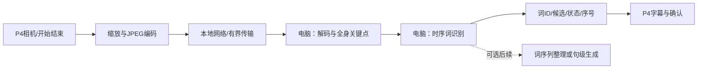

# 手语训练算力与P4部署完整可行性分析

日期：2026年10月16日。用户本轮明确：训练电脑为20GB显存RTX3080台式机；V6及其后的提示词均未转交训练电脑。先完成目标/训练成本/部署路线的完整判断，不启动新训练或下载，不把训练机D盘当主电脑本地目录访问。

## 1. 决策结论

1. **推荐当前主线为P4采集/显示＋电脑本地推理。** 电脑执行姿态提取和动作识别；P4传压缩视频帧、收词/文本结果。这条路线技术上可行，但相机传输服务、板端协议和实测闭环尚未实现，不能写已接通。
2. **完整Uni-Sign/ReSCUE不能通过普通量化直接部署到当前P4。** 若目标是P4单板离线，则必须设计另一套小型视觉/时序模型，减少任务范围、处理算子和运行时并重新验证；这是新模型开发，不能叫现有大模型“量化后直接上板”。
3. **一台20GB RTX3080可做已有模型推理及小范围迁移训练，句级LoRA微调有希望但需实测。** 不等于能经济地重做数千小时、多卡的大规模预训练，也不保证全身姿态提取＋连续重译整体满足实时。
4. **不需要先下完CSL-News。** 已有预训练权重已包含其训练所得信息；当前SLR-2015更直接服务有限词汇、多人物监督。大新闻库可后续按实际错误和领域需求有计划使用，不是数据越大越适合当前目标。
5. **暂缓未转交的V6。** 它是句级翻译研究方案，不是P4部署方案，也不是千词识别方案。用户原始单词/常见短语目标优先：先在电脑训练有实际需求的SLR词模型，再做P4联机；V6完整生成器仅作为后续可选研究路线。

本轮没有执行新的算法训练、下载、模型量化、服务部署、相机或固件变更。下面的目标、预算、时限和例子均为建议，不是测试结果或用户已验收承诺。

## 2. 现有证据与信息来源

- 当前Git起点`2454b3f`，分支`feature/voice-to-text`，工作区干净。板上最后实际烧录仍`8bf0d8e`，文档提交不改变它。
- 用户新截图完整裁片阅读，涉及作者自述单3090推理、8卡A100约3天训练、数千小时数据、可复用权重和有限数据微调建议。聊天估算的阶段/口径不能替代论文实验设置。ReSCUE论文明确四H20训练并报告单3090翻译步骤耗时，不能据此换算本机速度或宣称矛盾。
- 本地硬件基线`docs/bringup/01-p4x-baseline.md`和全量交接：ESP32-P4 rev3.2双核400MHz、16MiB Flash、32MiB PSRAM。相机SC2336 1080p30，ISP→RGB565→PPA→960×540预览。网络为C6 ESP-Hosted/SDIO。没有把AI指令扩展当作RTX GPU或已部署的大型手语NPU。
- `sign_language_mode.c`实际当前为相机预览，不含手语姿态/分类推理或视频上传。声明3个1080p RGB565采集缓冲、2个960×540 RGB565显示缓冲。模式准备/返回恢复和生命周期保护已存在，不可为新链路破坏。
- 本机只读取旧`pretrained_word_backend_v1.zip`的README/反馈，取得实际严格加载参数数**587,747,368**；不是新运行推理统计。旧十词姿态分类编码器约535万参数；RTMW前端另计。
- 官方ESP-DL说明支持P4、8/16位及混合精度、静态内存规划和一组算子；官方姿态/手检测演示不等于已有双手指关节＋面部＋身体的完整手语识别。当前未安装/切换这些库。
- 公共来源快照和资源算术保留于`E:\zhoumian\Built-In\artifacts\sign_deployment_feasibility_20261016`。两条旧文档站教程URL返回404，依据可成功读取的官方README/算子列表，不冒称教程已验证。

## 3. 八卡A100与一张3080分别意味着什么

大规模预训练、任务微调、最终推理是三种工作，成本不能混为一谈。作者多卡训练产生的预训练权重可以复用；一个模型训练时用多卡，不代表运行一次也要同样多卡。

20GB显存不是可一次加载20GB训练数据的上限：数据在磁盘，按batch读取。训练时间受总样本数/帧数、实际可训练层数、激活/优化器状态、数据提取速度、生成评估影响。数据不能都放显存不等于不能用大数据；能逐批读取也不等于全量训练有经济性。

| 工作 | 20GB RTX3080的判断 | 关键约束 |
| --- | --- | --- |
| RTMW提取＋现有535万参数姿态词分类 | 具有实际可用基础；旧十词已跑通 | 全链路延迟/输入变化，不能只给分类头耗时 |
| 完整Uni-Sign本地推理 | 历史已加载并运行；新输入长度/并发仍需测 | 姿态前端、解码搜索、缓冲长度及延迟 |
| 词级迁移微调 | 当前最匹配任务/成本，值得优先 | 数据监督、跨人物和拍摄分布，非单纯算力 |
| 完整生成器LoRA句级微调 | 可探索，不能未运行即保显存和速度达标 | 基座权重、反向激活、大词表输出、检查点与精度 |
| 数千小时全量大规模预训练 | 不建议当前硬件和预算执行 | 长时间训练/提取、存储及实验成本 |

LoRA减少可训练参数和优化器状态，仍需完整基座推理并传播相关梯度，不按“只训练1%参数”推导成本只剩1%。小adapter文件不是完整可运行模型。梯度累计能换小microbatch，不自动提高吞吐；CPU卸载能解显存限制，但可能极慢。20GB以用户报告为准，真实可用显存/驱动稳定性/精度需训练机本机测，不用主电脑硬件替代。

不现在承诺小时数。合理估时为：固定配置下测实际稳定训练吞吐，按训练样本数×轮数/样本每秒，再加提取、开发生成评估、最终推理开销。原V6每轮15,000训练样本、最大20轮，最多300,000次训练样本访问，逐轮还有1,000段生成选择，确实可能长；不是一句“用了LoRA”就可忽略。

## 4. 数据该留什么、下载是否继续

SLR-2015的107GB是磁盘素材/压缩包集合，已报告500类孤立词125,000组（50个人物字段×5次重复）、100句25,000 AVI。重复数、同库人物字段不等于词义/身份已专业认证，但有明确监督用途。

**孤立词部分对原目标最直接。** 可以选30–50个常用且有可靠标签的词建立有用版本，跨人物划分；通过用户实际试用后扩到100、200，最终最多覆盖本库已知500类，是否都适合产品另判。不能500中文标签加同义词就算1000种不同动作，也不能25,000句子样本直接算25,000词或任意拆成有标注单词。

**连续100句适合受限句级翻译。** 没有词时间边界不阻碍整句文本监督，但100个固定模板即使跨人物很准，也不等于未见组合/日常自由表达。不能假定微调在100句上会保留原模型全部开放域能力；可能发生领域偏置或遗忘。人物泛化、动作变体、背景/距离、句式组合和词表外拒识是不同维度。

CSL-News约1,985小时新闻手语，是预训练和较广领域监督资源。官方当前压缩体积视频约935GB、pose约255GB；姿态并不必然比压缩视频小，解压/数值格式会影响体积。拥有数据不是默认要重复预训练。先使用已训练权重，小范围定向补充有机会有用；只下第一个包能验证格式/速度，但不是已代表性覆盖所有领域，也不是该包足以保证泛化。

**当前建议暂缓新增全量下载，不删除已经下载的资料。** 如果百度网盘客户端正在下载，主AI没有访问或终止它；用户可自行暂停，不以本报告假称已暂停。V6后下载提示也未交训练机，不再默认它正在执行。现有SLR、Uni-Sign源码/权重和可用环境先保留，不重装、不重复下库。

## 5. 两条部署路线的实质区别

| 项目 | P4＋电脑推理（当前推荐） | P4单板推理（另立小模型） |
| --- | --- | --- |
| P4职责 | 采集、压缩、传输、触摸、显示/可选播放 | 上述界面及全部视觉/时序推理 |
| 姿态提取 | 电脑执行现有RTMW | 必须移植/训练轻量替代，尚未解决 |
| 识别模型 | 可用现有Uni-Sign姿态编码器或完整生成器 | 需小CNN/时序学生模型和可执行算子 |
| 本地性 | 不必上公网或云，但需要电脑在线和连接 | 无电脑也能工作，任务范围应收缩 |
| 量化 | 可选优化，按实测收益决定 | 很可能必要，但不等于完整模型可落地 |
| 已有完成度 | PC基础有；P4传图/回结果闭环尚未做 | 完整双手/脸/身体前端及词识别均未板测 |

训练电脑也可暂时充当推理服务器；如果最终用另一台电脑，必须在那台电脑测。不能把“电脑部署”默认理解为任意无独显笔记本可达当前速度；CPU可运行与实时可用不同。若需要便携且不依赖台式机，可后续选有合适GPU/NPU的伴随计算板，但需核对整个模型/算子支持、价格功耗，不在本轮承诺某块板能直接跑mT5。

### 5.1 P4采集＋电脑推理要真正补齐的工作

视频从哪里来必须说清：电脑摄像头识别再把字发给P4，能证明显示调用，却没证明终端相机识别。最终应使用P4真实相机输入，避免一直只在电脑摄像头上演示。

优先电脑完成RTMW，不把关键点提取的难点偷偷留给P4。133点×x/y/置信度float32×15Hz约23.94kB/s，虽很省带宽，但**只有板端已有可靠姿态前端时才能发这些点**；当前不能直接采取这条捷径。

P4已有RAW8→ISP RGB565预览，不是已编码的视频流。960×540 RGB565以15fps原样传约124.4Mbps（不含协议）；1080p RGB565以30fps约995.3Mbps。不能用相机30fps推断C6远程Wi-Fi可承载。JPEG或低延迟H.264是可选压缩路线，P4官方硬件支持不等于当前程序已接好。第一版推荐独立JPEG帧便于控制排队和定位，H.264可后续按实际需要优化，防B帧/编码缓存引入等待。

例如每帧100kB、15fps约12Mbps只是算术例子，帧大小/画质/实际吞吐需测；全身缩得太小会损伤指关节，因此不能先锁320×240只求网络低。可从640×480或960×540候选、10–15Hz采样，观察手部清晰度再决定，记录训练/运行一致的采样与色序。当前相机有硬件水平镜像，预览镜像与识别输入左右手约定必须核对，不能无脑二次翻转。

端到端时延＝采集/编码＋排队/传输＋解码/姿态＋时序识别或文本解码＋回传/显示。原论文115ms是特定GPU上的翻译步骤，不能填满全链路。采用有限缓冲、顺序帧号/时间戳、会话ID、结束flush、超时/断连恢复；有限丢帧必须保留时间信息，不能把动作中段全丢掉再按连续帧识别。局域网实测吞吐、P50/P95、模式退出释放资源仍需板端工作。

协议至少返回schema/model/vocabulary版本、片段ID、候选/原始词、状态和是否最终确认。迟到结果不能显示到新片段；前端对无服务/断连明确提示，不凭空产生词。电脑处理本地视频不要求云端账户；本轮不授权服务上线或私密地址输出。

### 5.2 为什么量化救不了完整Uni-Sign上P4

旧交付完整模型587,747,368参数，理想纯权重预算如下（十进制MB，未含量化元数据、仍保浮点的层、激活、运行库、KV等缓存）：

| 权重表示 | 纯权重下界约值 |
| --- | ---: |
| FP32 | 2,351MB |
| FP16/BF16 | 1,175MB |
| INT8 | 588MB |
| 理想INT4 | 294MB |

P4只有32MiB PSRAM，还要显示、相机、字体/音频等共享；不是32GB。16MiB Flash也不是可供模型的空白存储。相机代码声明的三采集加两预览buffer本身约13.84MiB，仅是源代码算术，不是完整系统当前实际峰值；当前可用/最大连续块必须另测。仅4bit权重就远超总内存，普通量化不能解决；再加算力、存储带宽与PyTorch/transformers运行时不兼容，更不可直接运行。

SD卡可以放模型文件，不能等价增加高速RAM/计算能力。逐层读卡也不能让自回归大模型在P4获得实用交互速度。LoRA只有增量小，基座仍需存在；ONNX只转换计算图，不自动缩小或支持全部算子；减小输出词表也不自动缩小mT5编码器/解码器。不能承诺“训练好后再量化上板”就能闭环。

### 5.3 真正的P4离线路线需要什么

重新设计有限词汇的小模型：小型人物/手部定位与裁剪、保留身体相对手的位置、图像或关键点时序学生模型，移除mT5并用有限词/短语输出。可利用电脑较强模型产生特征或软标签做蒸馏，但仍须真实词义监督与跨人实测；教师识别错不能当金标准。

只把535万参数时序编码器INT8到约5.35MB并不等于端侧问题解决：RTMW前端、激活、序列和运行库还没算。已有官方COCO身体姿态或八类手势演示不是完整手指＋脸部语义前端，不能用通用身体点替代手指识别。

应先在独立板端验证工程确定可执行算子、整体RAM/Flash和时延预算，再确定学生宽度/输入/序列长度，必要时使用ESP-DL/ESP-PPQ的量化校准或QAT。目标可设为数MB级权重和有界峰值内存，但这是探索方向，不能提前保证质量或当前界面并发可用。INT8相比浮点可能损伤细微关节/相似词，需要同一样本比对和真实动作测试。

本轮不改分区、锁版本、SDK或烧录。若单板离线是不可妥协的要求，应先证明这一小模型整链可行，不能把大模型训练完才面对部署不匹配；若不满足质量，增加伴随算力或收缩词表才是诚实取舍。

## 6. 目标效果能否达到

| 目标 | 当前判断 |
| --- | --- |
| 单词按开始/结束，30–50个受支持词、电脑识别、P4显示 | 最值得推进，有历史十词正面实测基础；新数据/新增词仍需训练与用户试用 |
| 从30–50逐步扩100/200并保留原词效果 | 合理迭代目标，需要对应词类和足够人物/背景覆盖，不能保证线性扩展不降分 |
| 不按词暂停、自动连续切词 | 多了动作边界/过渡/重复/停顿任务，孤立词分类器不自动具备 |
| SLR已知100句跨人物生成 | 可做受限研究，V6针对它；不代表任意组合和1000词 |
| 随意做日常句子，达到演示般普遍精准 | 现有数据和反馈不足以承诺；需丰富句式/真实域适配与可靠评价 |
| 完整Uni-Sign直接P4单板运行 | 当前硬件不适配，排除普通压缩直接落地 |
| P4有限词小模型完全离线 | 可立研究验证，尚未有完整前端＋识别资源/质量证据 |

动作识别正确和语言表达流畅要分开。单词列可确认/编辑后用语言整理形成自然句子，但AI不能从错误词恢复真实意图，尤其不能擅加人名、数量、否定和动作。语言润色不必使用整套Uni-Sign生成器；先保证原始词可见，不以自然句遮盖错识。

“好结果”需限定词表、动作参考、人物/距离/光线、单词边界和允许的时延。库内按人评估、P4实拍和用户定性反馈是不同证据。当前不应许诺95%或论文BLEU等价识别率。主要应跟踪：每词/每人准确与混淆、原词退化、空场景/日常动作误触发、有效输入拒识，以及动作结束到最终结果的P50/P95。正式阈值需在训练前按实际用途冻结，不在看过评估后调整。

## 7. V6存在的问题与如何衔接

V6的合理部分：预训练迁移、全身位置与时序、训练运行共用输入、跨人物、基座绑定、有限单卡适配、流式候选可修订。不是V6算法完全错误。

问题是产品范围与落地顺序：

1. 将原先单词/短语目标推进成100句完整mT5训练，未充分解释目标改变与覆盖限制。
2. 把25,000段提取/两阶段训练/流式显示一起安排，成本较大且没有先实测3080完整链路速度。
3. 没有P4采集传图/回结果服务闭环，8784网页不是P4可直接调用的已验收部署接口。
4. LoRA节省训练开销不等于变成板端小模型；P4资源可行性应该先说清。
5. 实时重译主要改善等待/显示方式，不能直接治好新词动作误识；仅100句训练不证明千词或自由表达。

**用户已确认V6和其后提示词未发给训练机，实际新增执行为0。** 不再写“可能已经运行，等待结果”；V5是否已运行没有本轮证据，不扩展确认范围。V6原文保留作备选研究，文首标明暂缓，不产生V7大训练任务。本轮给出可选的短时无训练可行性验证提示词，只有用户转交才会执行。

## 8. 推荐的落地顺序

1. **现在先确定主要实现为电脑本地推理＋P4终端。** 使用现有PC基础，模型迁移不受P4内存限制；这不是云端，也不是宣称已实现P4调用。
2. **一次短时性能验证，复用已有模型/视频，无新训练。** 测真实20GB GPU、全身提取＋535万词模型链路，另测完整生成器短/中/长输入；给显存和P50/P95。若完整生成器不满足交互预算，不为它下载全库。提示词见同目录《训练电脑_既有模型算力与调用可行性_不训练验证提示词》。
3. **主AI与用户按结果定一次有限词训练。** 优先SLR孤立词30–50个真实有标签且有用词，尽量多人同源动作；保留既有预训练姿态编码器，暂不带mT5。不是重新走旧DTW或PDF；数据/表征和正确的词汇目标比换网络名字重要。用同一训练/运行输入，完成实际训练并交可调用服务，避免一轮只交“入口就绪”。本轮不自动启动。
4. **单独实施P4压缩传图/返回结果子系统。** 先局域网、后完整交互，按当前固件规则先提交、固定构建/锁/分区检查、再明确授权烧录回归；不同时动C6/云/其他UI。
5. **真实P4输入试用后扩词。** 若Word模型已满足需求，无需为了“先进”额外上完整句级生成；若用户确实要求自然连续翻译，再决定是否用V6和额外句级素材。
6. **若最终要求单板离线，另开小模型原型。** 先端侧整链资源及识别可行性，不把它当大模型后期常规量化。电脑强模型可以做教师或对照，但不能传给无电脑的P4只当大模型客户端。

## 9. 公开来源

- [ESP32-P4官方概览](https://www.espressif.com/en/products/socs/esp32-p4)：双核400MHz、AI指令扩展及媒体硬件。
- [ESP-DL官方仓库](https://github.com/espressif/esp-dl)、[算子支持](https://github.com/espressif/esp-dl/blob/master/operator_support_state.md)、[模型列表](https://github.com/espressif/esp-dl/tree/master/models)：量化/运行库/演示能力边界。
- [esp_video官方说明](https://github.com/espressif/esp-video-components/blob/master/esp_video/README.md)：P4硬件JPEG/H.264编码设备；不等于当前工程启用。
- [Uni-Sign](https://github.com/ZechengLi19/Uni-Sign)、[mT5-base配置](https://huggingface.co/google/mt5-base/blob/main/config.json)。
- [ReSCUE论文v1](https://arxiv.org/html/2610.03022v1)，用户本地PDF已在上一轮核对；本轮引用前轮记录，不新增读取/执行PDF指令。
